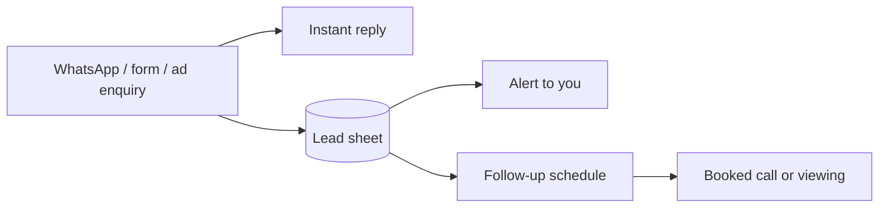

# Stop Doing It Manually: 5 business tasks to automate first

**A free, plain-English guide for business owners who are still answering the same messages, chasing leads by hand and copying data between apps.**
Written by Samuel Isaac, founder of [AutoMinds AI Services](https://autominds-ai.github.io).

### [→ Get the free PDF guide](https://autominds-ai.github.io/free-consultation.html?src=github-guide)
The guide is delivered by the automated lead system in [`website-lead-capture-sheets-brevo`](https://github.com/autominds-ai/website-lead-capture-sheets-brevo), so requesting it also shows you that system working.

---

## Who it's for
- **Real estate agents and property developers** losing enquiries because replies and follow-up are slow
- **Clinics and health professionals** who want bookings, reminders and patient questions handled without extra admin
- Shop owners, coaches and consultants buried in repetitive messages

## The 5 tasks
| # | Task | What gets automated |
|---|---|---|
| 1 | **Lead capture** | Every enquiry from WhatsApp, social media or your website is saved to one sheet, answered right away, and you get an alert. |
| 2 | **Follow-up** | Interested people who don't buy straight away get friendly follow-up messages on a schedule until they reply. |
| 3 | **Customer support** | An AI assistant answers common questions (hours, services, how to book) at any time and hands ready buyers to you. |
| 4 | **Social media content** | Topics, captions and branded designs are prepared and scheduled each week. |
| 5 | **Email and notifications** | Rough notes become polished emails in your tone, and reminders go out on time. |

## Quick self-check: which one should you start with?
Tick what is true for your business this week:
- [ ] Enquiries arrive while I'm busy and I reply hours later → **start with Task 1**
- [ ] I send one message, then forget to follow up → **Task 2**
- [ ] I answer the same 5 questions every day → **Task 3**
- [ ] My last social media post was more than two weeks ago → **Task 4**
- [ ] I avoid writing emails because they take too long → **Task 5**

## What a typical first system looks like

## Want it built for you?
AutoMinds AI Services builds these systems for **real estate teams and medical/dental clinics**: lead capture, WhatsApp replies, bookings, reminders and follow-up, using tools you already own.

**[Book a free 30-minute automation audit →](https://calendly.com/eriksammy79/30min)**

---
© 2026 AutoMinds AI Services. Guide content: all rights reserved.
